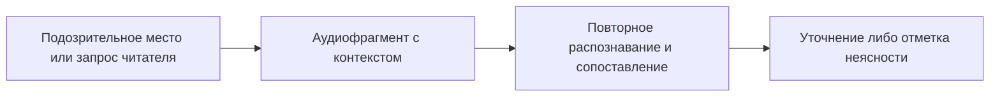

# Спецификация: отложенное уточнение распознавания

Записать в docs/deferred.md будущее улучшение: обнаружение подозрительных мест, вырезка аудио с контекстом, повторное локальное распознавание более точной моделью, сопоставление вариантов, сохранение неясности и истории с таймкодами. Один механизм можно использовать автоматически при обработке и по запросу «Уточнить по видео» при чтении; это не дополнительное объяснение материала. Пользователь явно отложил реализацию.

Приёмка: краткая запись с ценностью, причиной отсрочки и условием возвращения. Без реализации, выбора новой модели и изменения текущих критериев качества.
