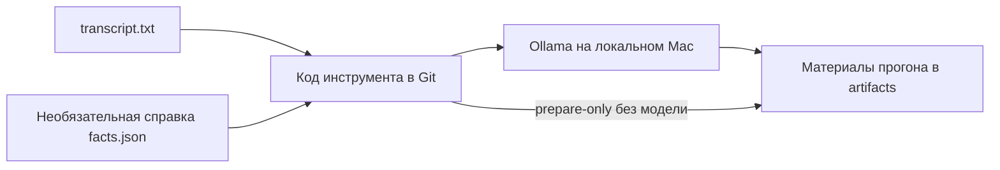

# Перенос инструмента редактуры

## Цель и границы

Перенести одноразовый `full-video/run_edit.py` из материалов видео в отслеживаемый код `video-processor/scripts/edit_transcript.py`. Это локальный инструмент эксперимента с Ollama, а не включение редактуры в основную команду `vidoc URL`.

## Поведение

На входе — явные `--transcript PATH` и `--output-dir PATH`; необязательные `--facts PATH` и `--title TEXT`. Без справки фактов используются пустые списки, заголовок по умолчанию — «Отредактированная расшифровка». Сохраняются формат расшифровки, разбиение на блоки, промпт, модель, параметры, проверка ответов, возобновление по хешу запроса и `--prepare-only`. Пути не зависят от cwd и расположения скрипта; относительные пути отсчитываются от cwd. Каталог результатов отделён от исходной расшифровки и справки: входы не должны перезаписываться выходами.

## Приёмка

- Скрипт запускается на другом видео и из другого рабочего каталога; в коде нет имени исходного видео, его ID или ссылок на его папки.
- `--prepare-only` создаёт запросы и manifest без обращения к модели; обычный запуск сохраняет ответы, прогресс, блоки и Markdown в заданный каталог. Заголовок задаётся входом.
- Возобновление использует только ответы для совпадающего запроса. Входные материалы сохраняются.
- Тесты не требуют Ollama или сети; проверяют переносимость путей, отсутствие фактов, заголовок и полный прогон с подменённым API/повторным использованием ответа.
- В AGENTS.md закреплено: artifacts — материалы, промежуточные данные и результаты, а код/промпты/скрипты — в Git. Правило не обязывает перемещать установленные локальные модели и окружения в этом изменении.
- Старый локальный скрипт удалён после проверки; локальные инструкции запуска обновлены, готовый текст и исходные ответы сохранены.
