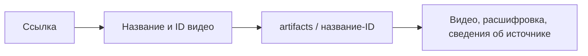

# Спецификация: папка артефактов MVP

Команда принимает только ссылку на YouTube-видео. Артефакты сохраняются в artifacts/ в корне проекта, исключённой из Git. Подпапка определяется названием видео с безопасным для файловой системы именем; YouTube ID различает одинаковые названия. Выбор папки пользователем не требуется.

Приёмка: ADR 0002 обновлён, /artifacts/ исключён корневым .gitignore, никаких изменений исполняемого кода. Папка создаётся при будущем запуске обработки.
