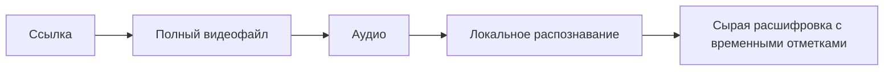

# Спецификация: решения для MVP распознавания речи

Зафиксировать согласованные границы MVP: локальная команда на Mac принимает ссылку на одно YouTube-видео и папку результата; сохраняет полный видеофайл, сырую расшифровку с временными отметками, ссылку и название источника. Распознавание выполняется локально, конкретная модель пока не выбрана. Редактирование текста относится к продолжению первой вехи.

Приёмка: краткий ADR по шаблону; ссылка в указателе ADR; вопрос о локальном или удалённом распознавании удалён; продуктовая веха различает MVP и итоговый читаемый текст. Выбор модели не выдан за принятое решение. Код не меняется.
