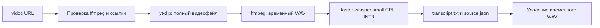

# Спецификация: локальная расшифровка YouTube-видео

## Результат

Команда `vidoc URL` в окружении video-processor принимает одну ссылку на YouTube-видео и сохраняет полный видеофайл, `transcript.txt` с временными отметками сегментов и `source.json` (URL, YouTube ID, название, язык, модель). Результат — распознанная речь, без редакторской обработки. Продуктовая веха читаемого текста остаётся незавершённой.

## Решение

Mac, Python >=3.11, yt-dlp для полного видео, ffmpeg для временного WAV mono 16 kHz, faster-whisper с multilingual small на CPU INT8. Модель скачивается при первом запуске, распознавание локальное. Папка результата: корневая `artifacts/<безопасное название>-<YouTube ID>/`, независимо от текущей рабочей папки. Путь определяется расположением исходников репозитория; запуск установленной копии вне репозитория не входит в MVP.

Название подпапки очищается от разделителей путей и ограничивается по длине для Mac; ID различает одинаковые названия. Обрабатываем только одно обычное видео, не плейлист и не прямой эфир. Ссылка watch с параметром list обрабатывает только видео. Повторный запуск использует ту же папку, сохраняет скачанное видео, не показывает устаревший transcript как новый успешный результат. Файлы результата записываются после успешного распознавания через временные файлы с заменой. Рабочий WAV удаляется и при ошибке; скачанное видео остаётся для повторного запуска. CLI сообщает этапы на русском, путь результата, при ошибке — этап и ненулевой код, при Ctrl-C — прерывание. Если нет ffmpeg, команда сообщает способ установки до скачивания.

## Критерии приёмки

- `vidoc --help` работает без загрузки модели; установка `pip install -e '.[dev]'` даёт команду.
- На выбранном видео https://www.youtube.com/watch?v=OdpcOLrxBnA команда получает видео, обе итоговые записи и временные отметки. Если доступ к YouTube/модели блокируется внешней средой, это явно указано; тестовые подмены не считаются доказательством реальной транскрипции.
- Тесты проверяют папку с кириллическим/опасным названием, одинаковые названия с разными ID, одиночную обработку, формат отметок, прохождение и ошибки этапов, удаление WAV, отсутствие ложного результата при сбое, CLI exit codes. Реальные сетевые вызовы в unit-тестах не нужны.
- Устаревший каркас слайдов и связанный сломанный тест удалены; health smoke можно сохранить. Ненужные зависимости pydantic и slides удалены.
- Документы по запуску и ADR отражают реализацию; артефакты, окружение, кеши не попадают в Git.
