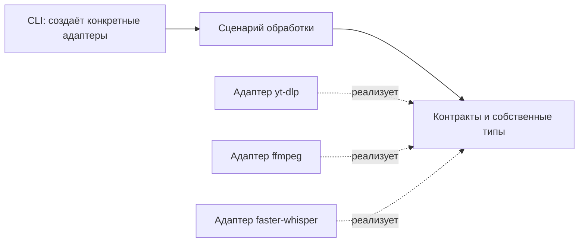

# Модульный процессор видео

## Согласованный результат

Упорядочить только существующую цепочку скачивание → извлечение аудио → распознавание. Сохранить поведение `vidoc URL`, форматы и расположение артефактов, модель small / CPU / INT8 и текущие сообщения. Редактор `scripts/edit_transcript.py` не изменяется. TUI, конфигурация, отдельная система сборки, PDF и подключение редактуры не входят в изменение.

## Устройство

Сценарий определяет последовательность, правила допустимого видео, имена артефактов, публикацию результата и очистку. Он получает зависимости явно, не импортирует адаптеры, yt-dlp, faster-whisper и не запускает ffmpeg. Стандартные файловые операции остаются в сценарии: универсальная абстракция хранилища пока не нужна. CLI создаёт три адаптера прямо в точке входа.

Контракты описывают получение метаданных/скачивание, проверку доступности/извлечение аудио, распознавание. На границе используются собственные типы метаданных видео, сегмента и результата распознавания; словари yt-dlp и объекты faster-whisper остаются в адаптерах. Результат распознавания сообщает фактическое имя модели для source.json. Корень моделей и кеша передаётся адаптерам явно и согласован с artifacts_root запуска.

## Правило расширения для ADR 0005

Новый этап добавляется явным изменением сценария. До добавления определяются его назначение, вход, выход, место и зависимости, ошибки и судьба временных/итоговых файлов при ошибке и отмене. Контракт принадлежит процессору, конкретный инструмент реализуется адаптером; сторонние типы не выходят из адаптера. Сценарий управляет порядком, адаптер не вызывает соседние этапы и не печатает в терминал. CLI передаёт зависимости и отображает сообщения. Общий реестр, динамический граф, DI-контейнер и механизм плагинов не вводятся без конкретной потребности. Проверяется новый этап с подменным адаптером и его реальная внешняя граница. Существующий этап заменяется без параллельного устаревшего пути, если реальный потребитель не требует совместимости.

## Приёмка

- Сквозной тест выполняет сценарий с явно переданными подменными адаптерами, без monkeypatch функций сценария и без внешних инструментов.
- Сохраняются проверки безопасных имён, одного видео, отказа для эфиров/плейлистов, таймкодов, повторного использования только полного видео, кодов CLI 0/1/130 и лёгкого --help.
- Ошибка этапа или отмена удаляет временное аудио и неполный TXT/JSON; завершённое видео остаётся. Сохраняется поведение ошибки до определения каталога.
- Ошибка ленивого декодирования не становится успешным результатом. Сохраняется проверка ошибки записи source.json после записи transcript.txt.
- Проверяется согласованность явного artifacts_root с расположением кеша/моделей адаптеров; source.json не зависит от константы сценария.
- Все тесты и Ruff проходят; новые зависимости не требуются.
- ADR фиксирует границы, правило расширения и мотивацию. README описывает устройство. ADR 0001–0004 сохраняют силу. Продуктовые термины и объём не меняются; открытое решение об авторизации не затрагивается.

## Альтернативы

Простое разбиение функций по файлам не обеспечит независимость сценария от инструментов. Универсальный конфигурируемый конвейер увеличит объём без текущего потребителя. Выбран явный сценарий с тремя контрактами и непосредственной передачей адаптеров.
