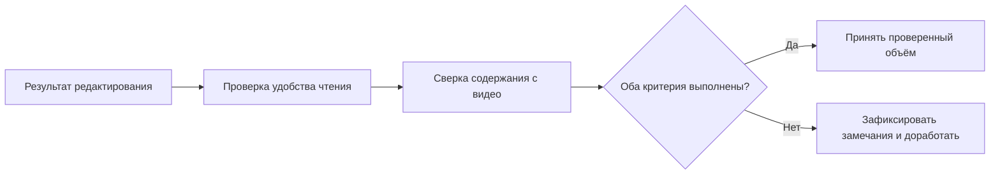

# Спецификация: критерии качества текста

Зафиксировать в кратком ADR 0004 критерии верности и читаемости верного источнику текста. Сохранить существенные мысли, аргументы, примеры, порядок рассуждения, оговорки, числа и имена; убрать речевой мусор, механические повторы, восстановить предложения и смысловые абзацы. Не добавлять факты и не превращать редактуру в пересказ или сокращение. Смысловой повтор и пример не считать мусором автоматически. Ошибки распознавания проверяются по видео, не исправляются догадкой; неясное место обозначается с привязкой к источнику.

Простой ручной протокол: один и тот же фрагмент 3–5 минут для сравнения вариантов; сначала прочитать текст отдельно, затем сверить с видео, записать конкретные замечания и временные отметки. Красивый слог не компенсирует искажённый смысл. Любое найденное существенное искажение/потеря/добавление требует доработки; нерешённые места явно обозначены. Принятие фрагмента не означает приёмки всего видео или вехи. Для готового материала сверяется весь текст с соответствующим источником. Автоматические метрики и оценка другой LLM пока не являются приёмкой.

Приёмка изменения: ADR по шаблону без дублирования, ссылка в указателе ADR и документе первой вехи, удаление закрытой строки из pending-decisions. Без выбора LLM и изменений кода.
